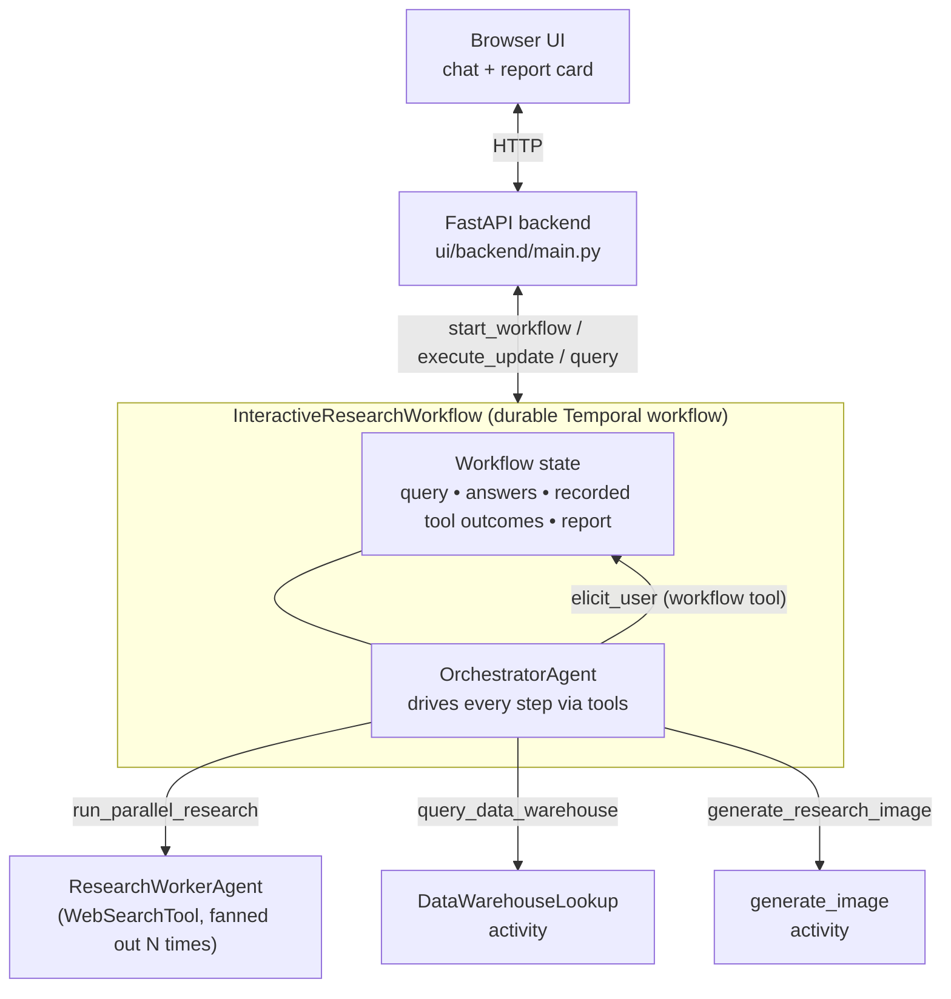
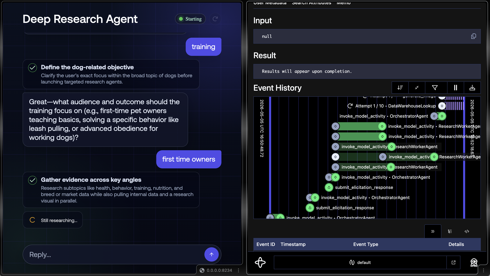

# Temporal Interactive Deep Research Demo (OpenAI Agents SDK)

A demo of an agentic deep-research workflow built on
[Temporal](https://temporal.io) and the
[OpenAI Agents SDK](https://github.com/openai/openai-agents-python). A single
orchestrator agent runs inside a Temporal workflow and drives the entire
research loop — clarifying questions, parallel research sub-agents,
proprietary-data lookup, image generation, and a final markdown report — by
calling tools.

This repository builds on the original
[Temporal Interactive Deep Research demo by @steveandroulakis](https://github.com/steveandroulakis/openai-agents-demos)
and has since diverged toward an agentic structure suitable for talks and
live demos. See [CHANGELOG.md](CHANGELOG.md) for the diff against the
upstream snapshot.

## Architecture



- **Workflow** (`openai_agents/workflows/interactive_research_workflow.py`):
  durable state: the query, pending and answered clarifications, and the
  outcomes the tools actually recorded (research findings and failed queries,
  the warehouse result, the image). It starts with the query as input; each
  answer arrives as a workflow update, and the UI reads status with a query.
  Before accepting the agent's report, the workflow checks those recorded
  outcomes, so a report that skipped the work fails visibly.
- **Orchestrator agent** (`openai_agents/workflows/research_agents/orchestrator_agent.py`):
  the only LLM-driven decision-maker. It asks two clarifying questions,
  chooses the research subqueries, calls the warehouse and image tools, and
  emits a structured `FinalizeReportRequest` (summary, markdown report,
  follow-ups) as its final output.
- **Research worker** (`openai_agents/workflows/research_agents/research_worker_agent.py`):
  a small sub-agent with `WebSearchTool`, fanned out in parallel, one per
  subquery. A worker whose model attempts are exhausted is reported to the
  orchestrator as a failed query; the report discloses the reduced coverage.
- **Activities**: `enterprise_data_activities.py` (a simulated data warehouse
  with injectable, retry-recoverable failures) and
  `image_generation_activity.py` (gpt-image generation; if every attempt
  fails, the report completes with a placeholder image).
- **Model fallback** (`openai_agents/model_provider.py`): each model call's
  Temporal retries move from the primary cloud model to a faster cloud model
  to a local Ollama model, which answers research questions from its own
  knowledge, labeled as such.
- **FastAPI backend** (`ui/backend/main.py`): a thin HTTP layer that starts
  workflows, forwards updates and queries, and serves the static frontend.
- **Frontend** (`ui/index.html`, `ui/success.html`): vanilla-JS chat UI that
  polls the workflow for state and renders the report inline or as a full
  page. The run's id is in the URL, so a reload resumes the conversation.

## Prerequisites

- Python 3.10+
- [`uv`](https://docs.astral.sh/uv/getting-started/installation/) for dependency
  management
- A Temporal server — either `temporal server start-dev` locally on
  `127.0.0.1:7233` (the default) or [Temporal Cloud](https://temporal.io/cloud)
- An [OpenAI API key](https://platform.openai.com/api-keys) with access to
  the orchestrator model (`gpt-5` by default), the research-worker model
  (`gpt-5-mini` by default), and an image model (`gpt-image-2-2026-04-21`
  by default). All three are overridable via env vars
  (`ORCHESTRATOR_MODEL`, `RESEARCH_WORKER_MODEL`, `OPENAI_IMAGE_MODEL`).
  See [Lower-cost setup](#lower-cost-setup) below if you don't have access
  to those defaults.

## Setup

```bash
# 1. Install dependencies
uv sync

# 2. Copy and edit the env file
cp .env-sample .env
$EDITOR .env  # at minimum, set OPENAI_API_KEY

# 3. Start a local Temporal dev server (in its own terminal)
temporal server start-dev
```

To use Temporal Cloud instead, uncomment `TEMPORAL_PROFILE=cloud` in `.env`
and run:

```bash
temporal config set --profile cloud --prop address   --value "<your-cloud-address>"
temporal config set --profile cloud --prop namespace --value "<your-namespace>"
temporal config set --profile cloud --prop api_key   --value "<your-api-key>"
```

See [Temporal environment configuration](https://docs.temporal.io/develop/python/environment-configuration)
for details.

### Lower-cost setup

If you don't have access to `gpt-5` or `gpt-image-2`, override the
defaults with smaller / earlier-generation models:

```bash
# in .env
ORCHESTRATOR_MODEL='gpt-5-mini'      # falls back from gpt-5
RESEARCH_WORKER_MODEL='gpt-5-mini'   # already the default
OPENAI_IMAGE_MODEL='gpt-image-1'     # falls back from gpt-image-2
```

To skip live image generation, e.g. for rehearsals, set
`DEMO_RESEARCH_IMAGE_PATH` to a previously generated file under
`temp_images/` (gitignored). The activity then returns that path instead of
calling the image API; the worker refuses to start if the file is missing, and
its banner shows `image='CACHED ...'`.

## Running the demo

One command starts everything in a tmux session:

```bash
scripts/start-demo                          # clean run
scripts/start-demo --warehouse-failures 8   # with the ~40s retry beat
scripts/stop-demo                           # stop it all
```

It checks the configuration first (the same validation the worker runs, plus
the OpenAI key) and refuses to start if anything is wrong. Then it opens one
tmux window per process:

| Window | What runs there |
|---|---|
| `temporal` | `temporal server start-dev`, only if no server answers at the configured address. An existing server is reused and left running by `stop-demo`. |
| `ollama` | `ollama serve`, only if the local fallback model is enabled and Ollama isn't running. It warns if the model isn't pulled. |
| `worker` | The worker, in a loop. After `scripts/crash-worker`, press Enter in this window to restart it. |
| `backend` | FastAPI backend and chat UI on <http://127.0.0.1:8234>. |
| `shell` | A shell in the repo for the helper scripts. |

Windows stay open after their process exits, so errors stay visible. Run with
`--restart` to replace a running session, or `--no-attach` to leave it in the
background (`tmux attach -t research-demo`). The dev server this script
starts is in-memory, so its workflow history is lost when the session stops.

To run the pieces by hand instead, use three terminals:

```bash
# Terminal 1: Temporal dev server (if not running already)
temporal server start-dev
#   Temporal UI: http://localhost:8233

# Terminal 2: worker (add DEMO_DATA_WAREHOUSE_RETRY_FAILURES=8 for the retry beat)
uv run --env-file .env openai_agents/run_worker.py

# Terminal 3: FastAPI backend + static frontend on http://127.0.0.1:8234
uv run --env-file .env ui/backend/main.py
```

Open <http://127.0.0.1:8234> in a browser, ask a research question, answer
the two clarifying questions, and watch the workflow run through to a final
markdown report. The Temporal UI shows the workflow history side-by-side.

The worker prints the *resolved* settings in its startup banner, e.g.
`warehouse_retry_failures=8 warehouse_outcome='recovers on attempt 9'
model_max_attempts=3 …`. Read the banner rather than numbers repeated in docs.



In the screenshot above, the two clarifying questions have been answered
and the orchestrator is fanning out research workers in parallel. The
Temporal UI on the right shows what's actually happening underneath:
each `invoke_model_activity` is one LLM call (the orchestrator's tool
call or a `ResearchWorkerAgent` sub-agent), and `submit_elicitation_response`
is the workflow update that delivered each user answer. The chat UI is
just a thin view over this workflow state.

## The two recovery beats

[TALK_RUNBOOK.md](TALK_RUNBOOK.md) is the presenter script. In short:

**Worker death.** Answer the first clarification. When the second one is on
screen, run `scripts/crash-worker` (a real `kill -9`), restart the worker (press
Enter in the `worker` window), and answer. The conversation continues: the
question and the first answer were never in the worker; a new worker rebuilds
the run from its Temporal history without repeating completed model calls.

**Activity retries.** Start with `--warehouse-failures 8`. The
`DataWarehouseLookup` activity fails its first 8 attempts with a simulated
connection reset and succeeds on attempt 9, about 40s later (1s attempts, 4s
apart). In the Temporal UI the pending activity's attempt count climbs while
the completed clarifications and research stay done. Valid values are 0-9: the
retry policy allows 10 attempts, and the worker rejects a value that would
exhaust them.

After a run, `scripts/show-history <workflow-id>` prints the activity
timeline: scheduled, started, failed and completed events with attempt counts
and failure messages.

## Demo helpers

The `scripts/` directory contains presentation helpers, not production
patterns:

- `start-demo` / `stop-demo`: launch and stop the whole stack in tmux.
- `crash-worker`: SIGKILL the worker recorded in `.demo-worker.pid` (written
  by the worker on startup), after checking that the pid really is a worker.
- `check-ports`: who's listening on 7233 / 8233 / 8234.
- `show-history <workflow-id>`: activity / failure / completion timeline from
  `temporal workflow show`.
- `demo-status <workflow-id>`: the backend's status and result for a workflow.
- `demo_smoke.py`: drive real runs end to end without the browser and record
  their outcomes.
- `validate_local_model.py`: check the local Ollama fallback model against the
  real agents, without OpenAI or Temporal.

## Development

```bash
# Tests (time-skipping Temporal test server; the worker-restart test starts a
# local dev server)
uv run python -m pytest tests

# Lint
uv run ruff check --select F401,F841
```

The workflow tests script both agents with a fake model and cover the full
flow, model fallback, partial research, an unavailable image, warehouse
retries, a report that skipped the work, and a worker replaced at the second
question.

## Known issues

See [KNOWN_ISSUES.md](KNOWN_ISSUES.md) for documented limitations.

## Attribution

Original work © Steve Androulakis. Substantial enhancements for the
agentic structure by Johann Schleier-Smith — see [CHANGELOG.md](CHANGELOG.md)
for the per-area summary and `git log` for the per-commit history.

## License

MIT — see [LICENSE](LICENSE).
